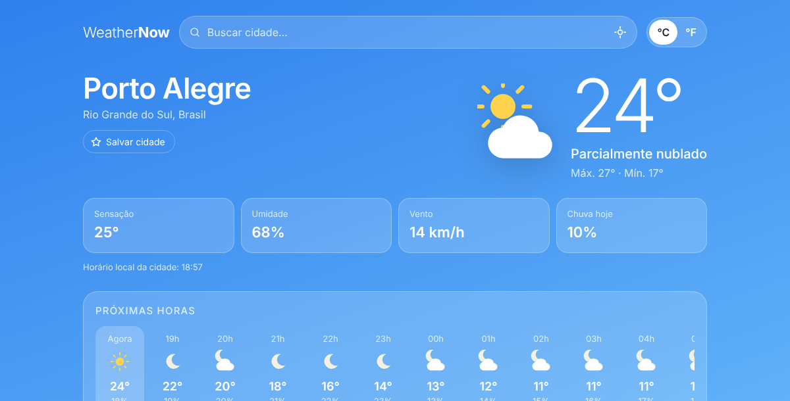

# WeatherNow — Previsão do tempo

Previsão do tempo em tempo real de qualquer cidade, com temperatura, umidade, vento e as condições do dia.

🔗 **[Ver o site no ar](https://iamviniciuslima05.github.io/PROJETO-WeatherNow/)**



## Funcionalidades

- Busca de **qualquer cidade** com sugestões enquanto você digita
- Botão para usar a **localização do aparelho**
- Temperatura, **sensação térmica**, **umidade**, vento e chance de chuva
- Previsão das **próximas 24 horas** e dos **próximos 7 dias**
- **Fundo que muda** conforme o céu (sol, nuvens, chuva, noite)
- Ícones do tempo desenhados em **SVG**
- Alternância entre **°C e °F**
- **Cidades salvas** para acesso rápido
- Mostra a última previsão salva se ficar sem internet

## Tecnologias

HTML5 · CSS3 · JavaScript · Fetch API · Open-Meteo API · localStorage

## Estrutura

```
index.html
css/style.css
js/script.js
```

## Como rodar

Não precisa instalar nada: baixe o projeto e abra o `index.html` no navegador, ou acesse a versão publicada acima.

> Os dados vêm da [Open-Meteo](https://open-meteo.com), uma API gratuita que não precisa de chave.

---
Feito por **Vinicius Lima** · [Portfólio](https://viniciuslimadev.netlify.app) · [LinkedIn](https://www.linkedin.com/in/viniciuslima25/)
